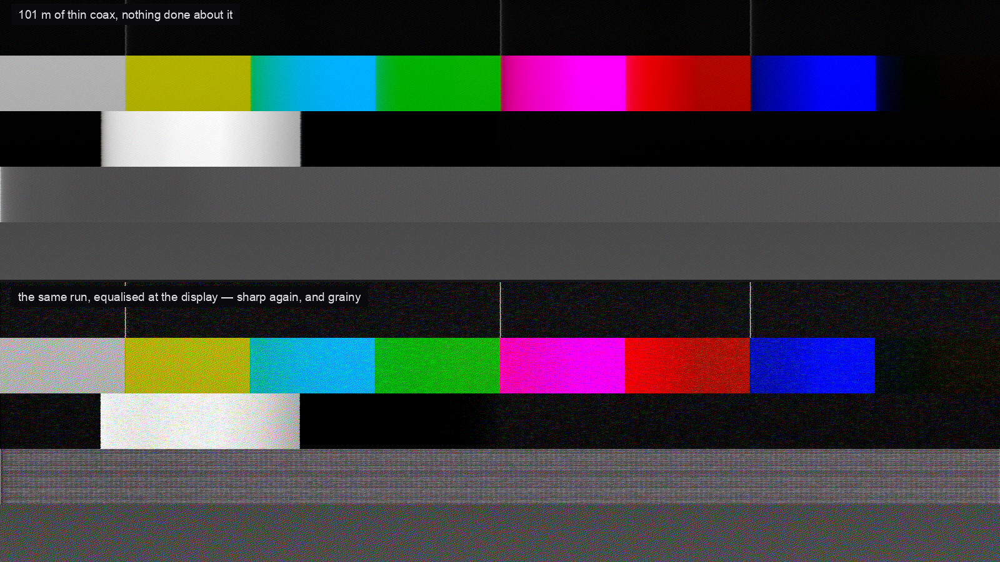

# 5-wire user guide

5-wire is a long run of VGA or RGBHV, and the amplifier at each end of it, as an FFGL effect
for [Resolume](https://resolume.com) Arena and Avenue. Your picture comes out soft, smeared, ghosted
and fringed the way it would after a long run of the wrong lead.

It's a transmission line rather than a glitch filter with a cable theme, and everything on screen
is what happens to a signal on its way down five conductors: red, green, blue, H and V. The idea
it's built on fits in one sentence: **coax loses the square root of frequency, and that loss has a
step response which is strictly one-sided.** A bright edge smears to the *right* and only to the
right, and the same curve is still going four hundred pixels later, which is what streaking is. If
it smeared both ways, it would just be a blur.



*Two renders of the plugin's own test card, both through the same 101 m of thin coax. The top one
has nothing done about it. The bottom is the same run with the equaliser at the display wound up:
the fine stripes are back, and so is the noise.*

> **Before you rely on this:** the cable model is verified numerically by a harness that drives the
> real plugin class in a headless GL context. The response has unit gain at DC to one part in a
> hundred thousand, is strictly one-sided, never rises with frequency, and its measured −3 dB point
> tracks the analytic square-root law. The equaliser is proved to be the inverse of it and **never**
> to make a picture softer. One bright column through the whole six-pass chain comes out equal to
> the C++ kernel to within a thousandth of a level, on four different cables. The reflections land
> within two pixels of twice the cable's transit time. All 30 controls demonstrably change the
> picture.
>
> Still open: **it has never been loaded into Resolume**, or any other FFGL host. Everything above
> comes from the harness, so the parameter layout and the About block are unproven in a real
> inspector. The Windows build comes from CI and has never been loaded into Resolume on Windows.
> No real cable run has been photographed and compared against this: the loss and skew figures are
> the manufacturers' own, but the crosstalk, pickup and sync constants are calibrated by eye. Try
> it on a spare layer first.
>
> This codebase was created with AI assistance, directed and reviewed by a human author.

---

## Installing

Drop the plugin into Resolume's FFGL folder and restart Resolume:

```
macOS    ~/Documents/Resolume Arena/Extra Effects/
Windows  %USERPROFILE%\Documents\Resolume Arena\Extra Effects\
```

Avenue uses the same layout under its own folder name. There's also a macOS disk image and a
Windows installer in the release, which put it there for you.

The macOS builds are Developer ID-signed and notarised, so there's nothing to clear. The
Windows builds are unsigned; plugin files aren't gated the way `.exe` files are, so Resolume
loads them normally, and only the installer trips SmartScreen, once.

---

## Start here: pick a cable and a length

**Cable Type** decides more than it looks like it does. One choice sets the loss, the propagation
velocity, how far apart the conductors are in length, and how well the run keeps the room out:

| | What it stands for |
|---|---|
| **RGBHV Coax** | Five 75 Ω coaxes on BNC. What a fixed installation is made of, and near enough transparent at any length a room has. |
| **VGA Lead** | The moulded lead in the flight case. Three times the loss, and far more of the room gets in. |
| **Mini-Coax** | The compromise: real coax, but 28 AWG of it. |
| **CAT5 Balun** | Structured cabling and passive baluns. The pairs are twisted at deliberately different rates so they do not couple, which means they are genuinely different lengths — this is the one that fringes colour. |
| **Ribbon Loom** | No shield worth the name, conductors parallel for their whole length. Which is the definition of a coupling capacitor. |

**Length** is squared across the slider, so the resolution is at the bottom where it matters. The
difference between 2 m and 10 m is nothing; the difference between 90 m and 100 m is whether the
show works.

**Pixel Clock isn't decoration.** Everything in a cable happens in *time*, and the pixel clock is
the only thing that turns a nanosecond into a pixel. The same 30 m lead is invisible at 640×480 and
a clearly visible ghost at 1600×1200. That's the surprise people get when they change
resolution and blame the new projector.

---

## The ghost needs two mismatches

**Termination** is the load at the far end. The middle of the slider is 75 Ω, which is right,
and each half is one of the two ways of being wrong. Below it, somebody has left a terminator on
a through connection and the repeat comes back **dark**. Above it, there's a high-impedance input
with nothing terminating the run, and the repeat is **bright**.

**Ghosting** is the other half, and it's the one people don't expect: it's the mismatch looking
back *into the amplifier*. A reflection has to make the return trip and then be sent forward again,
so an output stage with a proper series resistor just absorbs it. **Set Ghosting to zero and
there's no ghost at any termination.** The effect hasn't been switched off; that's what a
correctly back-matched amplifier does.

Where the repeat lands isn't a control. It's twice the cable's transit time, converted to pixels
by the pixel clock, and every bounce is softer than the last because it's been down the cable two
more times.

**Bounces** is how many of them to draw. Past the fourth there's nothing left.

---

## Pre-Emphasis and Cable EQ are the same filter, and they are not the same control

This is the bit I built the plugin to show, and it's worth two minutes.

Both of them invert the cable, and both bring the picture back. What's different is **where they
sit relative to the things that joined the signal in between** (the noise, the reflections, the
crosstalk, the hum):

- **Cable EQ** is the equaliser at the display. It's *after* all of that, so it lifts the noise and
  the ghost along with the picture. A hundred metres equalised at the receiver is sharp **and
  grainy**, and there's no setting that isn't.
- **Pre-Emphasis** is the same correction applied at the amplifier, *before* any of it. The picture
  comes back and the noise doesn't, and you pay for it in **Headroom** instead, because
  pre-emphasis overshoots every edge and the overshoot meets the output stage's rail. Turn Headroom
  down and you can watch the whites clip.

That's why a real distribution amplifier offers both, and the plugin ships the same run as three
presets (**Long Haul**, **Equalised** and **Pre-Emphasised**) so the difference is one click
apart.

**EQ Length is a length, not a frequency.** A real cable equaliser is calibrated in metres, and so
is this one. Set it short and the picture stays soft; set it long and it rings, with a bright
outline on the trailing side of every edge. Setting it to something other than **Length** is the
ordinary way of getting it wrong, and it looks like what it is.

---

## The things that are not effects

Several of the most recognisable artefacts here have no control of their own, because they're
consequences.

**Skew** separates the three conductors in time, so vertical edges grow coloured fringes. On coax
cut from one drum it's nearly nothing and the control is nearly dead, which is what coax is
*for*. On a CAT5 balun it's tens of nanoseconds and every edge has a red and a blue side.

**Crosstalk** couples a neighbour's *rate of change*, not its level, because that's what mutual
inductance does. So it draws coloured outlines on edges and never tints a flat area, which is how
you tell crosstalk from a bad white balance. It also gets weaker as the cable gets softer,
because there's less rate of change left to couple.

**Hum** is on the sync conductor as well as the picture. That's why the bar *bends* the lines it
passes through instead of only dimming them. Whether it crawls or stands still depends on **Mains**
against your composition's frame rate: 50 Hz on a 50 Hz frame rate puts every line at the same phase
and the bar doesn't move at all.

**Ingress** is a transmitter down the road. Each line catches the carrier at a different phase,
which is what turns it into a herringbone rather than vertical stripes. **Screening** scales hum and
ingress together, because they arrive by the same route: no cable is good at keeping mains out and
bad at keeping radio out.

**There's no Roll control.** Sync came down the same cable, and a rolling frame is what's left
when the receiver can't find it. Wind **Sync Level** down and the picture jitters, then tears, then
runs. **Sync On Green** puts sync on the green conductor, so a bright green line loads the sync tip
and the picture wobbles on just the shots that are green.

Length buys **jitter**, not loss of lock. An H sync pulse is tens of kilohertz against a pixel clock
of a hundred megahertz, so a long run barely touches the sync amplitude. What it takes is the
*edge*, and a slow edge is a slicer that's less sure when the line started.

---

## The receiving end

**DC Restore** is the clamp that holds black at black. A video signal is AC coupled, so without a
working clamp its average is forced to zero and a bright area pushes everything after it *down*.
That's streaking, and it's why an overexposed caption leaves a dark trail across the rest of the
line. Wind it down for a receiver that's given up.

**Sample Phase** is the "auto adjust" button on the front of every VGA monitor. At the right phase
the receiver samples each pixel where the signal has settled; half a pixel out it samples the
transition, and fine vertical detail loses contrast and shimmers. On a sharp source it barely
registers; on a cable-softened one it's the difference between legible and not.

**Gain**, **Red**, **Green**, **Blue** and **Headroom** are the amplifier at the *sending* end:
per-channel drive, the way a distribution amplifier gives you three trims. **Output Gain** and
**Black Level** are the display end.

---

## Presets

| | |
|---|---|
| **House Run** | A proper installation: five coaxes, terminated, near enough transparent. The preset that proves the plugin is not simply a blur. |
| **Long Haul** | A hundred metres of thin coax with nothing done about it. |
| **Equalised** | The same run, fixed at the display. Sharp, and grainy. |
| **Pre-Emphasised** | The same run, fixed at the amplifier. Sharp, and clean, and short of headroom. |
| **Unterminated** | Nobody terminated the far end and the amplifier has no series resistor. |
| **Skip Lead** | The lead out of the bottom of the flight case, run across a floor full of dimmer packs. |
| **CAT5 Extender** | Passive baluns over structured cabling. Every vertical edge grows a colour fringe. |
| **Losing Sync** | Sync on its last legs. Lines land in the wrong place and the frame has started to run. |
| **Tired Amp** | An amplifier that has been in the rack since the last century: the clamp has given up and the channels have drifted apart. |
| **Dead Run** | Everything at once, for the shot where the picture is meant to be falling apart. |

Picking a preset overrides the controls it covers; moving one of them hands control back and the
dropdown falls to **Custom**. Pixel Clock and Mains are never covered, on purpose: the first is
the raster you're running and the second is a fact about the country you're in.

---

## Try it in a browser first

There's a full browser demo at **[5-wire-demo.stoatworks-labs.com](https://5-wire-demo.stoatworks-labs.com)**.
It runs the plugin's own shaders on real pixels with the plugin's own controls, so it's a fair way
to find out what the effect does before installing anything. It isn't the plugin (no Resolume, no
composition), and the page says so and lists its own gaps.

---

## If something looks wrong

**The effect does nothing at all.** Almost always a shader that wouldn't compile, which from
Resolume's side looks like silence. The log says which pass and what the driver reported:

```
macOS    ~/Library/Logs/5-wire/5-wire.YYYY-MM-DD.log
Windows  %LOCALAPPDATA%\5-wire\logs\
```

**Everything is soft and no control fixes it.** Check **Length** against **Pixel Clock**. A hundred
metres at 340 MHz has thrown away almost everything above a twenty-pixel period, and no equaliser
recovers what's under the noise (a real one can't either). That's why the number on **EQ Length**
matters more than the amount.

**Ghosting is turned up and there's no ghost.** Termination is at 75 Ω. A ghost needs a mismatch at
*both* ends.

**Skew does nothing.** Cable Type is coax. It's meant to.

---

## Licence and source

MIT. Source, releases and issues: **[github.com/stoatworks-labs/5-wire](https://github.com/stoatworks-labs/5-wire)**.
